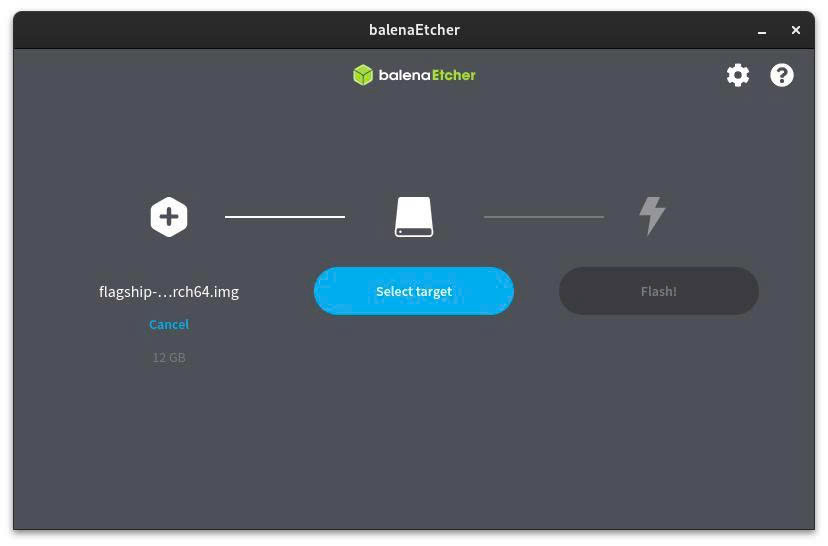
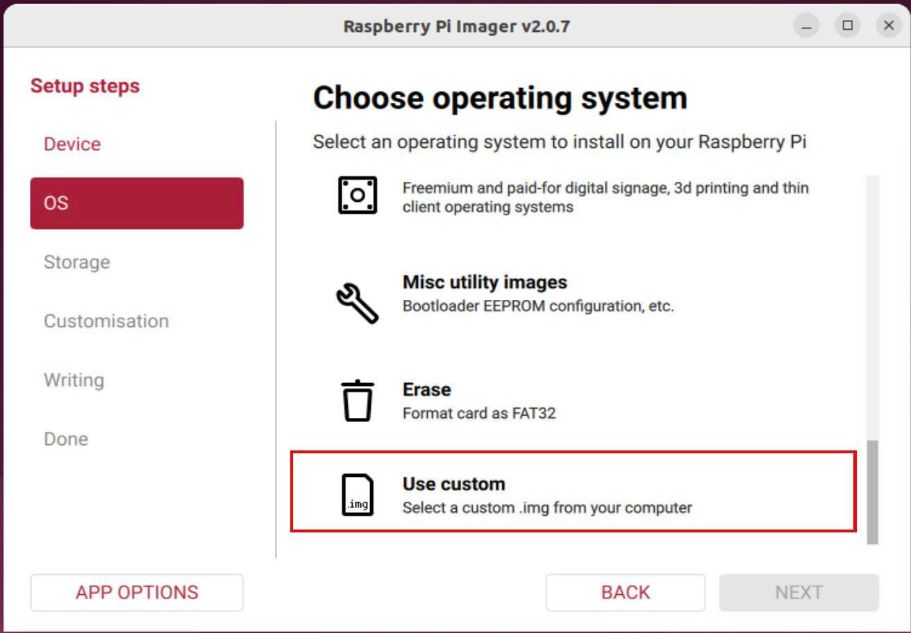
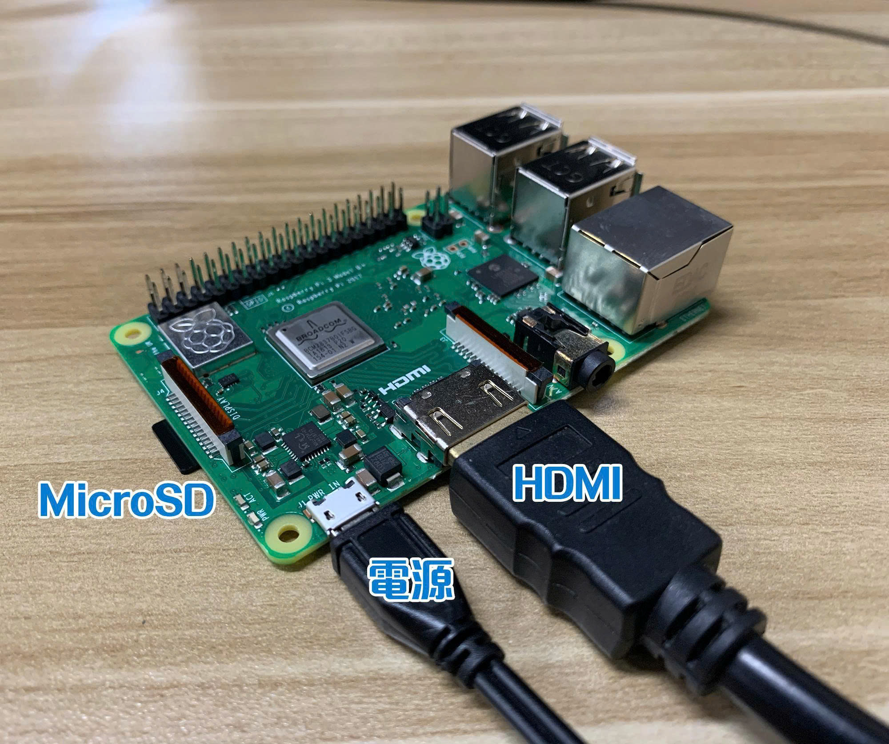

# Build yocto for raspberry pi 4 or 5

## Welcom

Welcome! This is a brief guide on building a Raspberry Pi (4 or 5) image using the Yocto Project. You will use the Yocto Project to build a reference operating system named Poky.

This project is implemented specifically for the Raspberry Pi board. The primary reference source is: [https://docs.yoctoproject.org/6.0/index.html](https://docs.yoctoproject.org/6.0/index.html)
---
### Link dowload Images for raspberry pi 4
link : https://drive.google.com/file/d/1BeTwrJgJrftdyocIphyfQraGfj0eLWLw/view?usp=sharing
---
## 📑 Table of Contents

1. [Build Host Requirements](#1-build-host-requirements)
   - [1.1. Operating System ](#11-operating-system)
   - [1.2. Required Tools and Versions](#12-required-tools-and-versions)
2. [Step-by-Step Guide](#2-step-by-step-guide)
   - [2.1. Installing Host Packages](#21-installing-host-packages)
   - [2.2. Cloning bitbake-setup using Git](#22-cloning-bitbake-setup-using-git)
3. [Hardware Customization for Raspberry Pi](#3-hardware-customization-for-raspberry-pi)
   - [3.1. Clone meta-raspberrypi](#31-clone-meta-raspberrypi)
   - [3.2. initialize the build environment](#32-initialize-the-build-environment)
   - [3.3. add layer to configuration](#33-add-layer-to-configuration)
   - [3.4. configure target machine in localconf](#34-configure-target-machine-in-localconf)
4. [Build the Image](#4-building-the-image)
5. [Flash Image to SD Card](#5-flashing-the-image-to-an-sd-card)
---

## 1. Build Host Requirements

### 1.1. Operating System

Use a Linux operating system (Ubuntu, Debian, Fedora, etc.) to set up the build environment. Alternatively, you can use Windows Subsystem for Linux (WSL) on Windows.

### 1.2. Required Tools and Versions

Ensure the following tools are installed with their corresponding minimum required versions:

| Tool | Minimum Version |
|---|---|
| Git | 1.8.3.1 |
| GNU tar | 1.28 |
| Python | 3.9.0 |
| GCC | 10.1 |
| GNU Make | 4.0 |

**Note:** The host machine requires at least 140 GB of free disk space. High RAM capacity and maximum available CPU cores are recommended to optimize build performance (32 GB RAM recommended).

---

## 2. Step-by-Step Guide

### 2.1. Installing Host Packages

```bash
sudo apt-get install build-essential chrpath cpio debianutils diffstat file gawk gcc git iputils-ping libacl1 libcrypt-dev locales python3 python3-git python3-jinja2 python3-pexpect python3-pip python3-subunit socat texinfo unzip wget xz-utils zstd
```

You also need to ensure that the `en_US.UTF-8` locale is enabled:

```bash
locale --all-locales | grep en_US.utf8
```

---

### 2.2. Cloning `bitbake-setup` using Git

```bash
git clone https://git.openembedded.org/bitbake
```

Initialize the build environment using the following command:

```bash
./bitbake/bin/bitbake-setup init
```

By default, `bitbake-setup init` is an interactive script that will prompt you to make several selections:

1. Select a configuration (e.g., `poky-wrynose`):

```bash
Available configurations:
1. poky-master        Poky - The Yocto Project testing distribution configurations and hardware test platforms
2. oe-nodistro-wrynose OpenEmbedded - 'nodistro' basic configuration, release 6.0 'wrynose'
3. poky-wrynose       Poky - The Yocto Project testing distribution configurations and hardware test platforms, release 6.0 'wrynose'
4. oe-nodistro-master  OpenEmbedded - 'nodistro' basic configuration
...

Please select one of the above configurations by its number:
2
```

```bash
Available bitbake configurations:
1. poky             Poky - The Yocto Project testing distribution
2. poky-with-sstate Poky - The Yocto Project testing distribution with internet sstate acceleration. Use with caution as it requires a completely robust local network with sufficient bandwidth.

Please select one of the above bitbake configurations by its number:
1
```

Next, choose a target machine. Since our objective is to build for Raspberry Pi, you can temporarily select option 4 (or option 1). Later, we will add the `meta-raspberrypi` layer and modify the `MACHINE` variable specifically for the Pi.

```bash
Target machines:
1. machine/qemux86-64
2. machine/qemuarm64
3. machine/qemuriscv64
4. machine/genericarm64
5. machine/genericx86-64

Please select one of the above options by its number:
1
```

```bash
Distribution configuration variants:
1. distro/poky
2. distro/poky-altcfg
3. distro/poky-tiny

Please select one of the above options by its number:
2
```

```bash
Enter setup directory name: poky
```
---
## 3. Hardware Customization for Raspberry Pi

### 3.1. Clone `meta-raspberrypi`

From the project root directory (at the same level as the `poky` directory), run:

```bash
git clone -b wrynose https://git.yoctoproject.org/meta-raspberrypi ../layers/meta-raspberrypi
```

### 3.2. Initialize the Build Environment

```bash
source poky/oe-init-build-env
```

### 3.3. Add Layer to Configuration

```bash
bitbake-layers add-layer ../layers/meta-raspberrypi
```

At this point, the Raspberry Pi layer has been added. You can view supported Raspberry Pi machine configuration options in the directory: `../layers/meta-raspberrypi/conf/machine/`.

### 3.4. Configure Target Machine in `local.conf`

For Raspberry Pi 4 (64-bit):

```bash
bitbake-config-build enable-fragment machine/raspberrypi4-64
```

For Raspberry Pi 5:

```bash
bitbake-config-build enable-fragment machine/raspberrypi5
```
---
## 4. Building the Image

```bash
bitbake core-image-minimal
```

**Note:** This process takes a significant amount of time depending on your host hardware specifications. You can monitor system resource usage (RAM and Disk Space) during the build process using the following commands:

Command to monitor RAM:
```bash
watch -n 1 free -h
```

Command to monitor Disk Space:
```bash
watch -n 1 df -h
```
---
## 5. Flashing the Image to an SD Card

Once the build process is complete, you can write the generated image to a microSD card. The output files are located at:
```bash
/poky/build/tmp/deploy/images/raspberrypi4-64/
```

Next, flash the `.wic` image file onto the microSD card so that the Raspberry Pi 4 can boot from it.

There are two ways to flash the image:

### Method 1: Using Raspberry Pi Imager or balenaEtcher (Recommended / Easy)

<p align="center">
  
  
</p>

### Method 2: Using the `dd` command on Linux

1. **Verify the target block device:**
```bash
lsblk
```
Example output:
```text
NAME        SIZE TYPE MOUNTPOINTS
sda         256G disk
└─sda1      100G part /
sdb          32G disk
└─sdb1       32G part /media/sdcard
```

2. **Unmount all partitions on the SD card:**
```bash
sudo umount /dev/sdb1
```

3. **Flash the `.wic` image to the SD card:**
```bash
sudo dd if=core-image-minimal-raspberrypi4-64.rootfs-20261101073510.wic of=/dev/sdb bs=4M status=progress conv=fsync && sync
```

4. **Boot the Raspberry Pi:**
   * Insert the microSD card into your Raspberry Pi 4.
   * Connect a monitor via the micro-HDMI port.
   * Connect a keyboard if necessary.
   * Connect the USB-C power supply to power on the board.
   * Observe the boot process on screen.

<p align="center">
  
</p>
